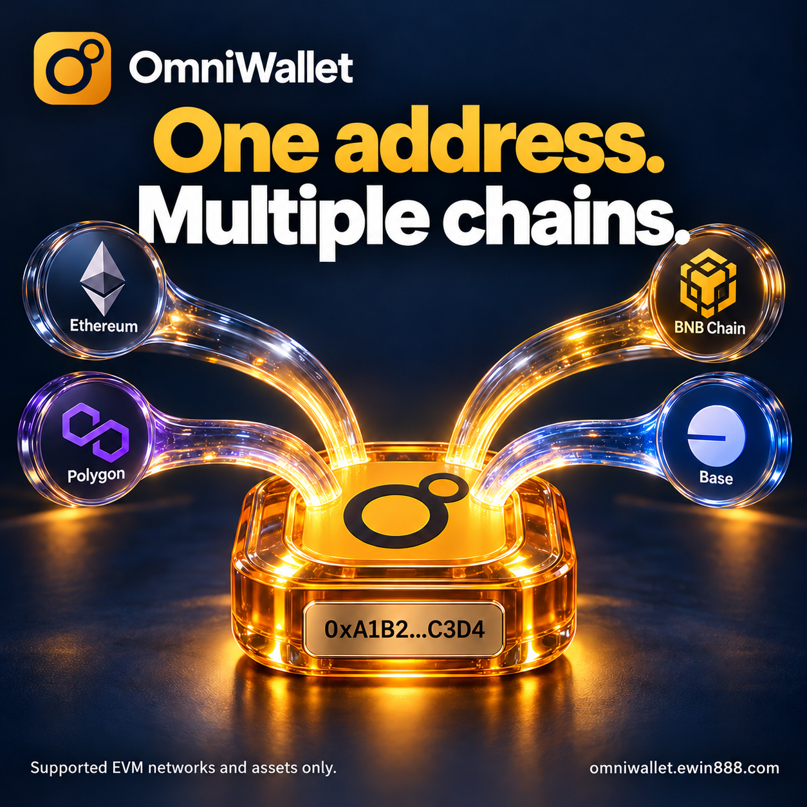

# OmniWallet integration examples

**[Try the browser webhook lab →](https://ewin888.github.io/omniwallet-integration-examples/)**

No installation or account. Four synthetic examples show how raw JSON bytes affect HMAC-SHA512 signatures. The interactive lab is available in English and Japanese.

[](https://omniwallet.ewin888.com/coins/?lang=en&utm_source=github&utm_medium=organic_content&utm_campaign=multichain_image_github_20261021#lookup)

[Explore supported coins and networks](https://omniwallet.ewin888.com/coins/?lang=en&utm_source=github&utm_medium=organic_content&utm_campaign=multichain_image_github_20261021#lookup)

Accept crypto payments with OmniWallet. Use these official examples to understand signed payment notifications and explore the sandbox API before integrating.

[繁體中文](README.zh-TW.md) · [日本語](README.ja.md) · [한국어](README.ko.md)

## What is OmniWallet?

**OmniWallet is a crypto payment platform for merchants and developers.** It helps businesses accept supported cryptocurrencies such as USDT and USDC through payment links, hosted checkout, a payment API and POS.

**One address. Multiple chains.** Use the same receiving address across supported EVM chains, with incoming transfers identified by their actual network. Coverage depends on the supported network and asset.

Typical uses include:

- **Freelancers and agencies:** send a payment link for an agreed project without building a checkout website.
- **Online shops and SaaS teams:** integrate crypto checkout and receive signed payment-status notifications in your own application.
- **Physical stores:** use POS to present a payment QR code and check the payment in the merchant console.

[Explore OmniWallet](https://omniwallet.ewin888.com/?utm_source=github&utm_medium=organic_content&utm_campaign=integration_examples) · [Fees](https://omniwallet.ewin888.com/pricing/) · [Supported assets and networks](https://omniwallet.ewin888.com/coins/) · [API documentation](https://omniwallet.ewin888.com/docs/api/)

## How this repository helps you integrate

Before choosing an API currency code, try the free [supported coin and network lookup](https://omniwallet.ewin888.com/coins/?utm_source=github&utm_medium=organic_content&utm_campaign=asset_lookup_20261020#lookup). Search `USDT`, select a network, and compare the displayed token contract. No account, API key or wallet connection is needed. This searches OmniWallet's supported list; it does not check balances or transfers.

If you want to connect your store or application to OmniWallet, start here to understand two parts of that integration:

| Example | What you can learn |
| --- | --- |
| Offline webhook lab | Why changing JSON can break a payment notification's signature, and why retries need separate handling. |
| Read-only Postman collection | How to check sandbox availability and inspect supported currencies, networks and token contracts. |

The offline lab works without an OmniWallet account. To explore actual merchant API responses, create a separate sandbox account and use your own sandbox key. For a no-code payment link, begin with the [merchant setup guide](https://omniwallet.ewin888.com/en/guides/accept-usdt-payments/).

## Try the offline lab

Use Node.js 22.18 or later. The published experiment was checked with Node.js 26.1.0. No account, API key, dependencies, network calls or funds are needed. You can inspect the source before running it; no package installation is required.

```sh
git clone https://github.com/ewin888/omniwallet-integration-examples.git
cd omniwallet-integration-examples
npm test
```

Or run only the experiment: `node examples/ipn-raw-body-lab.mjs`.

The lab prints `passed: 9` and `productionReady: false`. It demonstrates these distinct cases:

| Case | Expected lab result |
| --- | --- |
| Original UTF-8 body | Record for business validation |
| Identical bytes redelivered | Recognize exact redelivery |
| Amount changed, old signature | Reject signature |
| JSON reformatted, old signature | Reject signature |
| Short signature | Reject signature |
| Non-hex signature | Reject signature |
| Amount updated, same payment/status, new valid signature | Record for business validation |
| Valid signature, malformed JSON | Reject JSON |
| Receiver restarted, same body | Record again: memory deduplication was lost |

These labels belong to the lab, not the payment API. The signature format is OmniWallet HMAC-SHA512 with the `x-omni-sig` header; other providers may use different formats. Fixtures, identifiers and the sample secret are synthetic and intentionally public.

## Inspect the Postman collection

Import `postman/omniwallet-sandbox.collection.json`. Its default URL is the separate test environment. It contains only:

- `GET /v1/status` — public availability check.
- `GET /v1/currencies` — currency codes; requires your own sandbox key.
- `GET /v1/full-currencies` — network/contract details; requires your own sandbox key.

For the last two requests, create `omniwallet_sandbox_api_key` in your **local Postman Vault** and limit its allowed domain to `omniwallet-dev.ewin888.com`. Keep its real value out of collections, shared variables, screenshots and issues. Do not replace the sandbox URL with production while using a sandbox key.

`npm test` checks this collection offline and sends no requests. The public sandbox status was verified separately; the keyed examples have not been exercised with merchant credentials. This repository has not been published to Postman's API Network.

## What this example does not implement

The lab is not an HTTP receiver, payment SDK or production fulfilment service. A valid signature alone is not proof that an order is paid or may be fulfilled. The in-memory set does not provide durable deduplication, freshness or replay protection after restart. Plan durable receipt storage and transactional business idempotency; independently validate the order, currency, network, amount and authoritative payment state. No live payment, payout, custody or account-mutation operations are included.

## Further reading

- [Full experiment and explanation](https://omniwallet.ewin888.com/en/guides/verify-payment-webhooks-nodejs/?utm_source=github&utm_medium=organic_content&utm_campaign=integration_examples#run)
- [Official API reference](https://omniwallet.ewin888.com/docs/api/)
- [Merchant setup guide](https://omniwallet.ewin888.com/en/guides/accept-usdt-payments/)
- [Node.js timingSafeEqual documentation](https://nodejs.org/api/crypto.html#cryptotimingsafeequala-b)
- [Postman Local Vault documentation](https://learning.postman.com/docs/use/postman-vault/use-vault-secrets)

Product availability depends on the supported asset, network, account and market. This repository makes no promise of availability in every country. Questions about these examples can be filed as issues; omit keys and customer data. Product enquiries: service@ewin888.com.

## License and attribution

MIT license for the files in this repository. The main OmniWallet service and its source are not included or licensed by this repository. Examples and documentation were prepared with AI assistance and checked against the published product documentation and executable offline checks.
